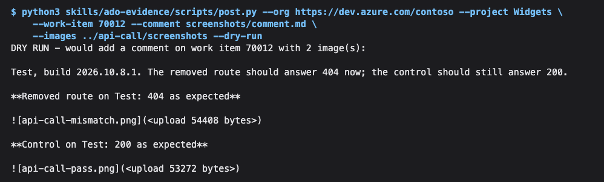

# ADO evidence

Posts images with captions as a markdown comment on an Azure DevOps work item, or revises a comment already posted, then reads it back and checks that every image rendered and matches its file. Made for test evidence from [api-call](../api-call/), but any images will do. A screenshot that shows more than the evidence is cut down first by `crop.py`, with no imaging library.

It comes as a skill: ask Claude to post the evidence on a work item, and it drafts the comment, previews it, and posts once you approve the text. The script also runs on its own.

## How it works

1. `post.py` uploads each image named by `{{image:file.png}}` in your markdown as a work item attachment, and puts the embedded image in its place.
2. It adds the comment in markdown, or with `--edit` replaces the text of one you already posted.
3. It reads the comment back and checks that the stored text matches, that every uploaded image is drawn in the rendered comment, and that each one matches the local file. An image may appear more than once, or beside other images. It prints `ok` or `FAIL` for each check, and exits 1 if any fails. It also exits 1, with no check lines, when it stops on an error. If that comes after the comment was added, the message begins `comment N was posted`: fix that comment with `--edit N` rather than posting again. If the comment request itself fails in a way that does not say it was refused, such as a 5xx, a dropped connection or an answer that is not the JSON expected, the message begins `the comment may have been posted`, or `comment N may have been posted` with `--edit`. A 4xx, or Azure DevOps's sign-in page, means the comment was refused. Whatever the message, look at the work item before running it again.

## Demo

`--dry-run` prints the comment exactly as it would be posted, with each image's size in place of the upload, and touches nothing:



The images in that sample are [api-call](../api-call/)'s own demo screenshots, which is the usual pairing: api-call produces the evidence, ado-evidence posts it. The command in the image is run exactly as drawn, from `skills/ado-evidence`, with `--images` pointing at api-call's screenshots. `screenshots/shoot.py` takes the image again from a clone.

## Use it

Install it from a Claude Code prompt in a terminal:

```
/plugin install ado-evidence --marketplace davidlambl/claude-extensions
```

Answer `y` to add the marketplace, then choose a scope.

Requirements: Python 3, and the Azure CLI signed in (`az login`), or `AZURE_DEVOPS_TOKEN` holding either a Microsoft Entra access token or a personal access token. `post.py` tells them apart by shape: an Entra token is a JWT and goes as Bearer, and anything else goes as Basic with an empty user name. `post.py` verifies Azure DevOps's certificate. On macOS, python.org's Python has no root certificates until its `Install Certificates.command` has run; there `post.py` uses certifi's instead, once `pip install certifi` has installed it.

```sh
python3 skills/ado-evidence/scripts/post.py --org https://dev.azure.com/my-org --project "My Project" \
  --work-item 123 --comment shots/comment.md --dry-run
```

`--dry-run` prints the comment as it would be posted and touches nothing. `--images DIR` names the folder the images are in, when it is not the comment's. `--edit COMMENT_ID` revises a comment instead of adding one.

A comment, with `{{image:...}}` where each image goes:

```markdown
Test, build 2026.10.8.1. 404 is the removed route; 200 is the control.

**Removed route, after: 404 as expected**

{{image:removed-after.png}}

**Control, after: 200 as expected**

{{image:control-after.png}}
```

## Cut a screenshot down

A screenshot of a whole window carries blank space around the evidence. `crop.py` cuts a PNG down with the standard library alone: it reads any PNG that is not interlaced, at every depth and colour type, and writes an 8-bit PNG beside it, never over the input.

```sh
python3 skills/ado-evidence/scripts/crop.py shot.png --squeeze --out shots/query.png
```

| Option | What it does |
| --- | --- |
| `--squeeze` | Closes up every run of identical rows, then of identical columns, longer than the gap to the gap. Every row and column that differs from its neighbour stays, so a blank editor, an empty results pane and the space between a status bar's two ends go, and nothing else. A full-screen SQL Server Management Studio window comes down to the query, the results and the status bar, with the server details beside "Query executed successfully". |
| `--gap N` | The pixels a squeezed run keeps; 16 by default. |
| `--box LEFT,TOP,RIGHT,BOTTOM` | Keeps the region from LEFT,TOP up to but not including RIGHT,BOTTOM, clamped to the image. With `--squeeze`, the box is cut first. |
| `--grid` | Writes `shot-grid.png`, the image ruled every 100 pixels and labelled with its coordinates, to read a box's edges from. On its own. |
| `--out FILE` | Where the result goes; `shot-cropped.png` beside the input otherwise. A file `--out` names that exists is replaced only with `--overwrite`; the default name is the script's own to replace, and the input never. |

It prints one line of JSON: the image's size, the file written and its size, the box as used, and the rows and columns squeezed. With no option it prints the size and writes nothing. A full-HD screenshot takes about a second, and a 2560 x 1440 one whose every row uses the slowest PNG filter about two. A JPEG, an interlaced PNG, a damaged file, or one past 40 megapixels, 65535 pixels a side or 256 MB of pixel data, is refused with one line that says what to do.

## What it costs and touches

- **Posting acts as you.** It uploads attachments and adds or edits a comment under your Azure DevOps identity. Run with `--dry-run` first.
- **Your token goes to Azure DevOps only.** `--org` must be `https://dev.azure.com/<org>` or `https://<org>.visualstudio.com`. An attachment URL Azure DevOps answers with must belong to the same organization, at either of those two addresses, and hold no token. Otherwise the comment is not posted, and the URL is never requested. A redirect is an error, never followed.
- **What it prints is scrubbed.** Every line has the token masked, as is, percent-encoded, JSON-escaped or as HTML character references. So does the Basic value a personal access token goes as. The mask comes before any text is cut short, so a cut never leaves part of a token standing. An error body in UTF-16 is decoded first. A token encoded twice, or split into pieces, is not masked.
- **An image is named by its file name alone**, looked up in the images folder; a path, a drive such as `C:shot.png`, or any colon is refused.
- **Editing leaves the earlier images attached**, unreferenced; Azure DevOps keeps a comment's attachments.
- **`crop.py` reads one PNG and writes one**, beside it or at `--out`, never over its input, and reaches no network. A squeeze keeps only rows and columns of the input, in their order, and drops one only when it is identical to the one before it: nothing is blended, drawn or moved. A uniform area whose size carries meaning, such as a bar in a chart, shrinks like blank space, so charts are not squeezed. A 16-bit sample keeps its high byte; the colour chunks are carried over and the text, time and EXIF chunks are not.

## Dependencies

Python's standard library, and the Azure CLI for the token when `AZURE_DEVOPS_TOKEN` is not set. [certifi](https://pypi.org/project/certifi/) (MPL-2.0) is optional, needed only where Python has no root certificates of its own.
