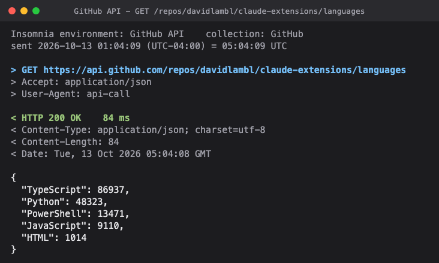
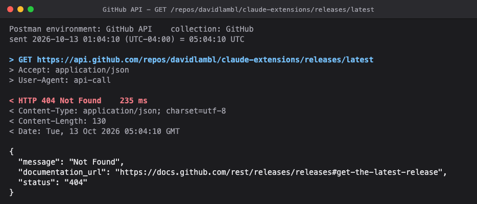

# API call

Calls an API the way your Insomnia or Postman collection would, with the collection's environment, auth and client certificate, and records the exchange as JSON with every secret masked. Ask for a screenshot and it draws the request and the response as a terminal shows them. What happens to the record and the image is up to you, or to Claude: post them on a work item, attach them to a pull request, keep them as evidence.

It comes as a skill: ask Claude to run a ticket's API test steps, to check an endpoint in an environment, or to compare one before and after a release, and it runs the calls, tells you what came back, and shows you the images. The scripts also run on their own.

## How it works

1. A source resolves the request, sends it, and prints the record. `sources/insomnia.ps1` reads Insomnia's local data (read-only): the base URL and variables from a global environment, with the top-level folder's own environment laid over it as Insomnia does, the API key or bearer auth on that folder, its headers, and the client certificate the collection holds for the host. `sources/postman.py` reads a Postman environment export and a collection export: their variables, and the API key, bearer or basic auth on the collection or on a top-level folder. Each keeps every secret inside its own process and refuses to print anything that would contain one.
2. `call.py` runs the source, checks the status against `--expect`, and writes the record as `<name>.json`. With `--shot`, it draws the record as a terminal shows it and captures it with headless Chrome as `<name>.png`. By default there is no title bar, only the terminal's content; `--frame` adds one.
3. `render.py` is that drawing on its own: a record in, an image out. Its `frame.html` holds the terminal's look and the optional title bars, which [`tools/screenshots`](../../tools/screenshots/) in this repository shares.

## The record

One JSON object per call, and the interface between a source and whatever reads it:

| Field | What it holds |
| --- | --- |
| `source` | `insomnia` or `postman` |
| `environment`, `collection`, `folder` | the names resolved from; `folder` is the top-level folder named with `--folder`, or else the one whose auth was used, or null. A Postman folder named with `--folder` that has no auth of its own uses the collection's. |
| `method`, `path` | `GET`, and the path as given, with a doubled leading slash reduced to one. The Insomnia source shows a secret in it as `********`. The Postman source refuses a record whose path holds one. |
| `url` | the URL as sent, with a space or a character outside ASCII percent-encoded, and an API key in the query shown as `********`. The host, the path and the rest of the base URL show as resolved. The base URL's userinfo is put back with its password as `********`, and its user too when it has no password, since that user is the credential. A secret that is also part of the base URL shows there as `********`, such as a tenant id that a credential carries too. The Insomnia source shows the URL as .NET sends it, with the host in lower case and a default port dropped. |
| `auth` | `none`, `API key in header <name>`, `API key in query parameter <name>`, `API key in cookie <name>`, `bearer token`, `basic auth as <user>` or `basic auth from the base URL as <user>`. A user that goes with no password is the credential and shows as `********`. Both sources write `basic auth from the base URL, with an empty user` for `https://:password@host`, and the Postman source writes `basic auth, with an empty user` for basic auth with no username. A secret in it shows as `********`. With an API key and credentials in the base URL, it names both, joined by `, and`. |
| `request_headers` | the headers as sent, their names as resolved. A value that came from the auth, or a header value with a template in it, shows as `********`, an API key in a cookie as `<name>=********`, and credentials from the base URL as `Basic ********`. A templated value of a standard header that never carries a credential, such as `Accept`, shows as resolved. The Insomnia source neither sends nor lists a content header such as `Content-Type`, which has nowhere to go on a GET. |
| `client_cert` | the client certificate's file name, or null |
| `status`, `elapsed_ms` | the response's status, and how long it took |
| `sent`, `sent_utc` | when it was sent, as ISO 8601 with milliseconds, in local time with its offset and in UTC, whatever the machine's regional format |
| `response_headers` | `Content-Type`, `Content-Length`, `Date` and `Location`, where present. The Insomnia source records them as .NET reads them, which puts a `Location` host in lower case. |
| `body` | the response body as text |

`call.py` adds `label`, `expected` and `verdict` (`PASS`, `FAIL` or null), and with `--shot` the image's path as `png`.

## Demo

A step through Insomnia that passed. The title carries the label and the path, the request shows the headers as sent, and the body is the response as returned, re-indented when it is JSON:



A step through Postman whose status did not match `--expect 200`. The image is still written, the status line is red, and the script exits 3, so the mismatch is reported as a finding rather than retaken:



Both come from `call.py` on macOS, against the GitHub REST API, with the environments in `screenshots/`: `insomnia/` is an Insomnia data folder of two files, one global environment `GitHub API` whose `baseUrl` is `https://api.github.com` and one collection `GitHub` with no auth, and `postman/` is the same as a Postman environment export and collection export. From this folder:

```sh
INSOMNIA_DATA=$PWD/screenshots/insomnia python3 skills/api-call/scripts/call.py --via insomnia --env "GitHub API" --collection GitHub \
  --expect 200 --warm --shot --out screenshots --name api-call-pass GET /repos/davidlambl/claude-extensions/languages

python3 skills/api-call/scripts/call.py --via postman --env "screenshots/postman/GitHub API.postman_environment.json" \
  --collection screenshots/postman/GitHub.postman_collection.json --expect 200 --shot --out screenshots --name api-call-mismatch \
  GET /repos/davidlambl/claude-extensions/releases/latest
```

Each writes the image over the one above, with its record and its `.html` page beside it; only the image is committed. The second exits 3, as it should.

## Use it

Install it from a Claude Code prompt in a terminal:

```
/plugin install api-call --marketplace davidlambl/claude-extensions
```

Answer `y` to add the marketplace, then choose a scope.

In auto mode, Claude Code's classifier can stop these scripts with `[Code from External]`. [Auto mode](../../README.md#auto-mode) in the repository's README says why, and how to let them run.

Requirements: Python 3.11 or later; for Insomnia, the app's data on this machine and PowerShell 7 (`pwsh`); for Postman, an environment export and a collection export; for `--shot`, Chrome, Chromium or Edge, found where each installs on Windows and macOS or on the `PATH`. Set `CHROME` to the browser's path otherwise. Built and tested on Windows and macOS; Linux is in place but untested.

```sh
# Insomnia: --env names a global environment ("Name", or "Name/Sub-environment"), --collection a collection
python3 skills/api-call/scripts/call.py --via insomnia --env "My API - Test" --collection "My API" \
  --expect 200 --warm --shot --out shots --name widget GET /api/widgets/42

# Postman: --env and --collection are the export files; --vars lays secrets kept out of the export over the environment
python3 skills/api-call/scripts/call.py --via postman --env "My API - Test.postman_environment.json" \
  --collection "My API.postman_collection.json" --vars secrets.json --expect 200 --shot --out shots --name widget GET /api/widgets/42

# A record drawn again, with a title of your own
python3 skills/api-call/scripts/render.py shots/widget.json --title "After: Test - GET /api/widgets/42"
```

| Option | What it does |
| --- | --- |
| `--expect CODE` | The status the step should return. A mismatch exits 3; the record and the image are still written. |
| `--warm` | Sends once untimed first, so a cold start does not show in the timing. |
| `--shot` | Draws the exchange and captures it as `<name>.png`, with its `.html` page beside it. The record is written first, so if the capture fails the record is kept, without `png`, and the script exits 1 with a message naming the record and the status. |
| `--frame BAR` | A title bar for the screenshot. Without it there is none, only the terminal's content, and a label given with `--label` opens the image as a line of its own. `native` draws the title bar of the system the capture is taken on: Windows, macOS or GNOME on Linux. `windows`, `mac` or `linux` draws that one wherever the capture runs. `render.py` takes the same flag. |
| `--label TEXT` | Leads the image's title, such as `After: Test`; the environment's name otherwise. |
| `--folder NAME` | The collection's top-level folder that carries the auth, when more than one does. The Insomnia source uses a folder's environment and headers only when it carries auth or is named here. |
| `--base-url-var NAME` | The variable holding the base URL, when it is not `baseUrl`. Variable names are case-sensitive. When the one named is not defined, the one variable whose name matches it ignoring case is used, such as `baseURL`; with two or more, the message names them. The Insomnia source does this only for `baseUrl`. |
| `--timeout SECONDS` | How long to wait for the response; 60 by default. The Postman source bounds each socket read with it, not the whole response. |
| `--vars FILE.json` | Postman: a flat object of values laid over the environment, for secrets kept out of the export. Every value in it is a secret wherever it is used, and so is an environment value typed secret. In the base URL or a key's name, such a value shows as `********`, and the record is refused if a response echoes it. Every call sends `Accept: application/json` and `User-Agent: api-call`, so a value equal to one of those names or values refuses every call. |
| `--cert PEM --key PEM` | Postman: a client certificate; `API_CALL_KEY_PASSPHRASE` unlocks an encrypted key. Insomnia's certificates come from the collection. |

`INSOMNIA_DATA` points at Insomnia's data folder when it is not in the usual place; the source says so if the folder is missing or holds no `insomnia.Workspace.db`. In Git Bash with `MSYS_NO_PATHCONV=1`, write it as `C:/Users/...`, since a `/c/Users/...` path is not converted. Exit codes: 0 for a call that returned, 3 for a status that did not match `--expect`, 2 for a command line it could not parse, such as a missing argument or an `--expect` that is not a number, and 1 for anything else that stopped the call or its screenshot.

Names are matched exactly, in their own letter case: an Insomnia global environment, sub-environment or collection, and a folder named with `--folder`. An accent stored as a letter and a combining mark, as macOS can write it, is the same text as the accent typed as one character, so the two match. When a name is not found, the message names those that differ from it only in letter case. Failing that, it names those that differ only in letter case or in characters it shows as escapes, such as no-break or zero-width spaces, however many. Failing that, it names the closest: those the fewest edits away, if that is within one edit for every five characters and no more than three edits. It lists three names at most, and says how many more. Each is quoted, with a control, format, bidi or invisible character, or a space other than U+0020, shown as its `\uXXXX` escape, and cut at 80 characters. Neither source picks one, since a name in another letter case may be another environment, such as production.

In Git Bash on Windows, which is also the shell Claude Code's Bash tool uses there, write the path with a doubled leading slash: `GET //api/widgets/42`, which `call.py` reads as `/api/widgets/42`. Or put `MSYS_NO_PATHCONV=1` in front of the command. Otherwise Git Bash turns `/api/widgets/42` into a Windows path such as `C:/Program Files/Git/api/widgets/42` before `call.py` starts, and `call.py` stops with exit 1 rather than send it. Either way, write the script's path, and every other file path, as `C:/Users/...`, which Git Bash passes on as written. With `MSYS_NO_PATHCONV=1` set, Git Bash converts no path at all, so Python reads `/c/Users/...` as `C:\c\Users\...`. A script path written that way is not found, and an `--out` folder written that way is made there without an error. `~`, `$HOME`, `$PWD` and `/tmp` are Git Bash paths too, and `cygpath -m` prints any of them in the `C:/` form.

A before-and-after pair is two runs of the same step, one per environment, each with a label: `--env "My API - Prod" --label "Before: Prod (current release)" --name removed-before`, then `--env "My API - Test" --label "After: Test (this change)" --name removed-after`.

## What it costs and touches

- **It sends real requests** to the environments you name, GET only. Pointed at production, it calls production: choose inputs that return test data, never a customer's.
- **A GET can still write.** Some endpoints create, register or change something on a GET, such as a duplicate check that registers an identifier it has not seen, answering 200 the first time. So before it runs a step, the skill reads the step and what is known about the endpoint for anything it creates, registers or changes. When neither says it writes, the step runs as an ordinary read. Outside production, for an endpoint that can write, it uses an input that leaves the call a pure read, such as one the system already holds, or asks you first and then sends the call once, without `--warm`. In production it never calls one, whatever its method or input: that step is yours to run. The scripts cannot tell such a call from a read, so when you run them by hand, that check is yours.
- **The images show the response body exactly as returned.** A JSON body is only re-indented, every string, number and literal copied as written. Invisible, format, bidi and non-ASCII space characters are drawn as `\uXXXX` escapes, and so are U+2800 and U+FFFC, which draw as a space. Every row runs left to right in the order its characters are written, is clipped to its own height, and ends in an ellipsis where it is too long for the window. A body of nothing at all is drawn as `(empty body)`, and one of line breaks alone as their escapes. Trailing spaces on a text line or a header value cannot be seen, a literal `\uXXXX` in a text body reads the same as an escaped character, and a line that really ends in `...` looks like one cut short. Look at each image before you share it.
- **Secrets stay in the source's process.** Keys, tokens and certificate passphrases are never printed, written or drawn, and a client certificate appears by file name only. A secret is a value in a credential position: an API key's value, a bearer token, a basic-auth password, a header value with a template in it, and a password in the base URL. A user that goes with no password, as in `https://TOKEN@host`, is the credential too. Each counts with every value substituted into it, at any depth. Every value in a `--vars` file is a secret wherever it is used. A templated value of a standard header that never carries a credential is configuration, not a secret: `Accept`, `Accept-Charset`, `Accept-Encoding`, `Accept-Language`, `Cache-Control`, `Connection`, `Content-Language`, `Content-Length`, `Content-Type`, `Host`, `Origin`, `Pragma`, `Referer`, `User-Agent`, `X-Forwarded-For`, `X-Forwarded-Host`, `X-Forwarded-Proto` and `X-Requested-With`, in any letter case.
- **Configuration is shown.** Hosts, ports, paths and the rest of the base URL, header names, an API key's name, the bearer prefix, a user beside a password, and the environment, collection and folder names show as resolved. A response that echoes one is printed, never refused. A secret that is also part of this configuration, such as a tenant id a credential carries too, shows there as `********` instead of refusing every call. A response that echoes it is still refused. The Postman source does not mask one in the typed path, and refuses the record.
- **A key goes in the auth, not in the base URL.** A key written into the base URL's path or query, such as an Azure Functions `?code=`, is part of the URL to the script. It shows in the record and the image, and a response that echoes it is printed. Put it in the folder's or the collection's auth, as an API key in a query parameter.
- **A source refuses to print anything that would contain a secret.** It looks for each secret in its own letter case, as is, trimmed of surrounding whitespace, percent-encoded, JSON-escaped or as HTML character references. A secret encoded twice is not looked for. A value under six characters is too short to tell from ordinary text and is not checked for. An error message still masks it, which can garble a word around it. A failed request's error has every secret in it masked, and is withheld whole if one would still show. When the base URL holds an `@` after its scheme, a failed request says only `the request failed: the base URL holds credentials that could not be parsed or reached; percent-encode any / ? # or @ in its user or password`, and quotes no part of the URL or its host. Percent-encode a user or password there: an unencoded `/`, `?` or `#` in one ends the host early, so the request goes to a host made of part of the credential, and the record shows it. A folder header whose value is typed in, not templated, is not a secret to the script and is drawn as typed, so keep secrets in environment variables. A Postman key outside ASCII is sent as its Latin-1 bytes, and an echo of those bytes percent-encoded is not looked for, so keep keys ASCII. A body whose declared charset does not match its bytes is drawn garbled, and a secret echoed inside it may not be found.
- **A malformed header or an empty credential stops the call before anything is sent.** A header whose name or value holds a line break, such as the newline at the end of a pasted key, is refused, so a shared collection cannot add headers or a second request. So is an Insomnia API key cookie whose name or value would split it into two cookies. An API key or bearer token that resolves to an empty value is refused too. From Postman it usually means a secret kept out of the export and no `--vars` file; from Insomnia, an empty variable or a sub-environment not chosen. A Postman basic password typed blank beside a username is sent, for an API that takes the key as the user, as `curl -u key:` does. A templated one that resolves empty is refused. No message quotes the value.
- **A redirect is recorded, never followed.** A 3xx is the response, with its `Location` header, so a key is sent only to the host the collection named.
- **It reads Insomnia's files and Postman's exports, and never writes them.** Insomnia: global environments and their sub-environments, and the top-level folder's own environment. A global environment whose name holds a `/` cannot be chosen, since `--env` reads `Name/Sub-environment`. `{{ name }}`, `{{ _.name }}` and `{{ _['name'] }}` templates; a value that names its own variable, as `{{ baseUrl }}/v2`, extends the one beneath it, resolved after the rest of its layer in the file's order. API key and bearer auth on a top-level folder, with the key in a header, a query parameter or a cookie; a folder set to No Auth counts as none. PFX and PEM client certificates, matched to the host by name and by port, 443 when none is given. Postman: collection exports in schema v2.1 or v2.0, and another schema is refused by name. Collection and environment variables, and `{{name}}` templates. API key, bearer and basic auth on the collection or a top-level folder; a folder with no auth of its own inherits the collection's, as in Postman. PEM client certificates. In both: variable names are case-sensitive, as in the apps. A template may nest five levels deep, and a value may resolve to 65536 characters; past either, or on a cycle of variables, the call stops before anything is sent, with a message that never quotes the value. A user and password in the base URL go as basic auth, as the Insomnia and Postman apps send them, unless the auth sets `Authorization`. Not supported: Nunjucks tags such as ``, Postman's dynamic variables such as `{{$guid}}` and scripts, request-level auth, Insomnia's collection environments.
- **Each image is written with its `.html` page, and each call with its `.json` record**, secrets excluded. The record is ASCII-escaped JSON, so no invisible character a response carried can hide in it.

## Dependencies

Python's standard library. On macOS, python.org's Python has no root certificates until its `Install Certificates.command` has run; the Postman source then uses [certifi](https://pypi.org/project/certifi/) (MPL-2.0) when it is installed, and says so when it is not.
